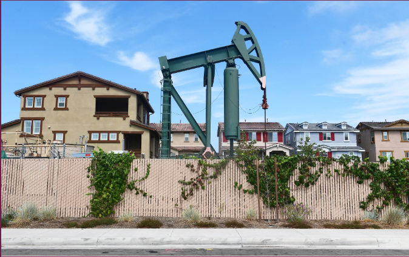

<head>
    <h1 style="color:Khaki">Powering Democracy</h1>
    
</head>
<body>
    <h2 style="color:palegoldenrod">Clean Energy Right Amendment</h2>
    
 We believe that access to clean and affordable energy should be a basic human right. Therefore ratifying it as an actual amendment that the government has to abide by makes the most sense to us. 

    
The Amendment would clearly state that affordable energy is a natural right that is protected by the government. This Amendment would protect the ability of citizens to have an equal opportunity, as based in the Equality of Opportunity precedent. Getting the Amendment ratified would require 3/4 of states to agree to ratify it. 

    

    <h3 style="color:palegoldenrod">Government</h3>
    
We have researched the definition of a natural right as described in the Constitution of the United States and the role of the government on similar subjects.

    
This contributes to the PBL by adding a backing to what the government has legally done in the past for other cases like in the PBL.

     
    
The Commerce Clause has very clear precedent in our situation, where energy is something that costs money to create and is something that is already federally regulated. Additionally, the creation of an Amendment is also evidenced by the Necessary and Proper Clause, as the regulation of energy is something that is almost indisputibly necessary for the federal government to regulate due to how people require energy to survive. 

    
Federalist 51 also supports the creation of this Amendment, as the government needs to be kept accountable using checks and balances.

    <h3 style="color:lightgoldenrodyellow">Four current event sources that relate to our topic:</h3>
    
The UN Historical Omission Framework <a href="https://energyblog.ethz.ch/human-rights/">(ETH Zürich Energy Blog)</a>: As detailed by the ETH Zürich Energy Blog, access to electricity is not recognized as a universal human right under the original 1948 Universal Declaration of Human Rights. Because standard grid architectures are physically limited and heavily dependent on localized investment, global frameworks historically omitted energy from "natural right" protections due to the baseline logistical reality that grids cannot inherently reach all populations without transactional economic agreements.

    
The Climate Justice Resource Paradox <a href="https://actalliance.org/act-news/cop31-four-issues-that-will-shape-the-summit/">(ACT Alliance / Christian Aid)</a>: A 2026 global policy outlook from ACT Alliance notes that even as organizations push for "energy democracy," the transition to clean grids relies on a massive influx of critical, finite minerals like lithium, cobalt, nickel, and copper. Because these resources are limited corporate commodities subject to property law, geopolitical leverage, and market extraction, energy cannot function purely as a natural right without creating physical resource injustices elsewhere.

    
 <a href="https://www.yesmagazine.org/environment/2022/04/14/energy-is-a-human-right">(YES! Magazine / Chomsky Analysis)</a>: Author Aviva Chomsky argues via YES! Magazine that under current global standards, our energy systems are geared primarily toward market-based production and profit, selling to whoever can best afford it. This operational reality demonstrates that legally and economically, energy functions as a restricted, state-regulated commercial asset rather than a naturally guaranteed human entitlement.

    
The Public Service and Derivative Law Framing <a href="https://www.sciencedirect.com/science/article/pii/S1364032125005659">(ScienceDirect / Journal Literature)</a>: Modern legal summaries found via ScienceDirect show that legal scholars remain intensely divided over whether to develop energy access protections under human rights models or standard public service frameworks. Instead of an independent "natural right," energy law operates primarily as a derivative mechanism tied to existing property, environmental, and corporate utility laws that govern human-engineered infrastructure rather than a self-sustaining natural resource.

    <h3 style="color:palegoldenrod">Chemistry</h3>
    
We can utilize our understanding of Chemistry to find a way to actually allow for clean energy to be a natural right. 

    
This contributes to the PBL because it will give more credence to our solution with backing by actual Chemistry.

    <h3 style="color:palegoldenrod">Literature and ERWC</h3>
    
We could make a connection to Chris McCandless and his journey to be completely independent, including being energy efficient.

    
This contributes to the PBL because it shows how a system could work on an individual level for a single person. 

     
    <h3 style="color:palegoldenrod">Nanotech</h3>
    
We recently presented conceptual ideas that used already existing components that allow for more efficient energy storage.

    
This contributes to our PBL because our stance is that clean water and energy should be a natural right. 

    <h3 style="color:palegoldenrod">Calculus</h3>
    
{
  "version": 1,
  "active": 1,
  "answers": {
    "route": "C",
    "startx": "24",
    "starty": "12",
    "endx": "24",
    "endy": "48",
    "direction": "Counterclockwise",
    "sensor": "S1",
    "sensorx": "30",
    "sensory": "30-9*sqrt(3)",
    "yp": "9*sqrt(3)",
    "xp": "6"
  },
  "checks": [
    {
      "passed": true,
      "attempts": [
        {
          "date": "2026-10-26T17:36:55.736Z",
          "signature": "[\"C\",\"24\",\"24\",\"12\",\"42\",\"Counterclockwise\",\"S1\",\"30\",\"30-9*sqrt(3)\"]",
          "result": "Optional check: review needed"
        },
        {
          "date": "2026-10-26T17:37:43.630Z",
          "signature": "[\"C\",\"24\",\"12\",\"24\",\"42\",\"Counterclockwise\",\"S1\",\"30\",\"30-9*sqrt(3)\"]",
          "result": "Optional check: review needed"
        },
        {
          "date": "2026-10-26T17:37:44.942Z",
          "signature": "[\"C\",\"24\",\"12\",\"24\",\"42\",\"Counterclockwise\",\"S1\",\"30\",\"30-9*sqrt(3)\"]",
          "result": "Optional check: review needed"
        },
        {
          "date": "2026-10-28T03:51:14.991Z",
          "signature": "[\"C\",\"24\",\"12\",\"24\",\"42\",\"Counterclockwise\",\"S1\",\"30\",\"30-9*sqrt(3)\"]",
          "result": "Optional check: review needed"
        },
        {
          "date": "2026-10-28T03:51:26.148Z",
          "signature": "[\"C\",\"24\",\"12\",\"24\",\"42\",\"Counterclockwise\",\"S1\",\"30\",\"30-9*sqrt(3)\"]",
          "result": "Optional check: review needed"
        },
        {
          "date": "2026-10-28T03:51:28.652Z",
          "signature": "[\"C\",\"24\",\"12\",\"24\",\"42\",\"Counterclockwise\",\"S1\",\"30\",\"30-9*sqrt(3)\"]",
          "result": "Optional check: review needed"
        },
        {
          "date": "2026-10-28T03:53:11.871Z",
          "signature": "[\"C\",\"24\",\"12\",\"24\",\"48\",\"Counterclockwise\",\"S1\",\"30\",\"30-9*sqrt(3)\"]",
          "result": "Optional check: entered answers match"
        },
        {
          "date": "2026-10-28T04:05:23.415Z",
          "signature": "[\"C\",\"24\",\"12\",\"24\",\"48\",\"Counterclockwise\",\"S1\",\"30\",\"30-9*sqrt(3)\"]",
          "result": "Completed with explanation; answers not required for advancement"
        }
      ],
      "hint": true,
      "reflection": "",
      "reason": "This information tells us which direction the thing went in and what the sensor sensed was the location of the thing.",
      "attest": true
    },
    {
      "passed": false,
      "attempts": [],
      "hint": false,
      "reflection": "",
      "reason": "",
      "attest": false
    },
    {
      "passed": false,
      "attempts": [],
      "hint": false,
      "reflection": "",
      "reason": "",
      "attest": false
    },
    {
      "passed": false,
      "attempts": [],
      "hint": false,
      "reflection": "",
      "reason": "",
      "attest": false
    },
    {
      "passed": false,
      "attempts": [],
      "hint": false,
      "reflection": "",
      "reason": "",
      "attest": false
    },
    {
      "passed": false,
      "attempts": [],
      "hint": false,
      "reflection": "",
      "reason": "",
      "attest": false
    },
    {
      "passed": false,
      "attempts": [],
      "hint": false,
      "reflection": "",
      "reason": "",
      "attest": false
    },
    {
      "passed": false,
      "attempts": [],
      "hint": false,
      "reflection": "",
      "reason": "",
      "attest": false
    },
    {
      "passed": false,
      "attempts": [],
      "hint": false,
      "reflection": "",
      "reason": "",
      "attest": false
    }
  ],
  "report": {
    "route": "",
    "headline": "",
    "plan": "",
    "younger": ""
  },
  "shift": 0,
  "projector": false
}

</body>
</html>